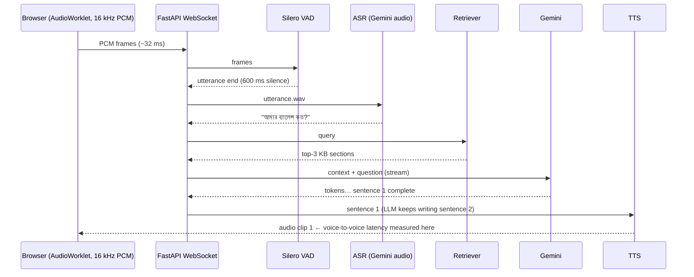

# Bangla Voice Bot

A real-time voice agent for Bangla telecom customer care. You speak in the browser and the bot answers out loud. It handles Bangla, English and code-mixed speech, and it grounds answers in a telecom knowledge base.

```
mic ──► Silero VAD ──► Gemini ASR ──► char-n-gram BM25 RAG ──► Gemini (streamed) ──► sentence splitter ──► Bangla TTS ──► speaker
            │                                                                                                   ▲
            └──────────────────────── barge-in: caller speaks while the bot talks → playback stops ─────────────┘
```



## What it demonstrates

| Requirement | Where |
|---|---|
| VAD, real-time streaming | `app/vad.py` (Silero, hysteresis, pre-roll, min-speech filter), WebSocket in `app/server.py` |
| Bangla / code-mixed ASR | `app/asr.py`: Gemini audio transcription (default), Whisper large-v3 on Groq, or faster-whisper (local); code-mixed instruction keeps English words in Latin script |
| RAG over telecom tariffs/policies | `app/rag.py` + `data/kb/telecom_faq_bn.md` |
| LLM conversation | `app/llm.py`: Gemini streaming, short spoken-style answers, refuses to guess, never asks for PIN/OTP |
| Bangla TTS | `app/tts.py`: Edge neural voice (`bn-BD`) or Meta MMS (offline) |
| Latency optimisation | sentence-level streaming TTS; per-stage timings in the UI and `logs/turns.jsonl` |
| Interruption handling | barge-in cancels the running turn (`CallSession.interrupt`) |
| WER evaluation, 8 kHz telephony, noise | `eval/eval_asr.py` (clean / phone / noise / phone+noise) |
| Privacy | phone numbers, emails and long digit runs are redacted in logs (`REDACT_PII=1`) |

## Quick start (Windows, CPU laptop)

```powershell
cd bangla-voicebot
python -m venv .venv
.venv\Scripts\activate
pip install torch --index-url https://download.pytorch.org/whl/cpu
pip install -r requirements.txt
copy .env.example .env      # then paste your GEMINI_API_KEY (the only key needed)
uvicorn app.server:app --port 8000
```

Open http://localhost:8000, click the mic, and ask something like *"সবচেয়ে সস্তা ইন্টারনেট প্যাক কোনটা?"* or *"amar balance koto?"*. Wear headphones, because speaker echo can trigger a barge-in. You can also type into the box to test without a mic.

Only a Gemini API key is needed (free tier). Gemini handles both transcription and replies; Edge TTS needs no account. The heavy compute is in the cloud, so it runs on an i3 with no GPU. Set `ASR_BACKEND=groq` for Whisper on Groq, or `ASR_BACKEND=local` and/or `TTS_BACKEND=mms` to run those stages offline (install the optional packages in `requirements.txt` first). Local ASR on CPU will be noticeably slower.

## Tests and evaluation

```bash
pytest -q                      # 62 offline tests, no keys needed
python -m eval.eval_rag        # retrieval: hit@1, hit@3, MRR
python -m eval.eval_asr --manifest eval/data/manifest.csv   # needs GEMINI key + your audio clips
python -m eval.latency_report  # p50/p90 per stage from your real calls
```

**Retrieval** on 20 labelled caller questions (includes code-mixed queries and an ASR-style misspelling, "রিচাজ"): **hit@1 85%, hit@3 100%, MRR 0.917**. The bot passes the top 3 to the LLM, so every question had its answer in context.

**ASR WER**: the 30-sentence test set in `eval/data/wer_sentences.csv` covers Bangla (15), code-mixed (10) and English (5) caller questions. Start the server and open **http://localhost:8000/record**: it shows one sentence at a time, you press Space to record and Space to stop, and it saves 16 kHz WAVs to `eval/data/my_clips/` and writes `eval/data/manifest.csv`. Then run `python -m eval.eval_asr`, which paces itself for the free tier, waits out rate limits, can `--resume` an interrupted run, and writes WER/CER per condition **and per category** plus the worst clips to `eval/results/asr_<time>_summary.md`. Your recordings are git-ignored; only the numbers need publishing. The `phone` condition passes audio through an 8 kHz telephone channel. `--rescore` re-scores a finished run with the current rules, with no API calls.

### ASR results

30 utterances (15 Bangla, 10 code-mixed, 5 English), one speaker, read in a normal room, transcribed by Gemini (`gemini-3.5-flash-lite`).
Scored after Unicode/punctuation/digit normalization and accepted spelling variants (কী/কি, কীভাবে/কিভাবে).

| Transcription prompt | Audio | WER | WER, loanword-insensitive | Wrong-script outputs |
|---|---|---|---|---|
| Original | clean | 39.9% | 30.1% | 10 / 30 |
| Original | phone (8 kHz) | 39.3% | 32.2% | 10 / 30 |
| **Script-control** | clean | **14.8%** | **9.8%** | 1 / 30 |
| **Script-control** | phone (8 kHz) | **14.2%** | **5.5%** | 0 / 30 |

What the errors turned out to be:

- **Wrong script, not mishearing.** With the original prompt, 10 of 30 transcripts were heard correctly but written in Latin letters
  ("Notun SIM tolte ki ki kagoj lagbe?") or partly in Hindi script. Explicit script rules in the prompt cut this to 1 of 30 and WER from 39.9% to 14.8%.
- **Loanword spelling.** Code-mixed speech has no single correct spelling: "net speed এত slow কেন" and "নেট স্পিড এত স্লো কেন" are the same words.
  The loanword-insensitive column counts common loanwords as the same word in either script.
- **Real mishearings that remain** include "data pack" → "terabyte" and "eSIM" → "একটি সিম". Notably, "সবচেয়ে **cheap** data pack" became
  "সবচেয়ে **ভালো** ডেটা প্যাক": an LLM-based recognizer can substitute a plausible word that changes the meaning, which a classic ASR model would not.
- **Telephone audio did not hurt.** The 8 kHz phone channel scored within noise of clean audio.

Limits: one speaker, 30 clips, one run per setting. Treat differences of a few points as noise; a larger multi-speaker set would be the next step.

## Design decisions

- **Character n-gram BM25, not word BM25.** Bangla is agglutinative: প্যাকেজ / প্যাকেজের / প্যাকেজটি share no whole-word token. Character 3–5-grams match across suffixes and also tolerate ASR misspellings. It needs no model download and runs in under 1 ms.
- **Unicode normalization before WER.** য়, ড় and ঢ় are Unicode composition exclusions, so NFC does *not* unify their two encodings. Without the explicit mapping in `app/textnorm.py`, WER counts visually identical words as errors.
- **Clause-streamed, parallel TTS.** The first chunk is cut at the first comma so speech starts before the LLM finishes the first sentence. Every chunk's TTS starts as soon as it exists, in parallel, while audio is still sent in order. The latency panel splits the wait into ASR, retrieval, LLM first token, LLM writing the first chunk, and TTS.
- **Two pipeline modes.** `cascade` makes a separate transcription call, then retrieval, then the LLM call: two network round trips, but it scales to a large knowledge base. `direct` sends the caller's audio and the whole (small) KB to Gemini in one call, which streams `TRANSCRIPT: ...` on the first line and then the answer. That removes one round trip (about 3 s on a Bangladeshi connection in testing). Retrieval still runs on the transcript for the sources panel and logs. `python -m eval.latency_report` compares the two modes.
- **Free-tier quota handling.** Gemini's free tier allows about 5 requests per minute *per model*. On a 429 the bot parks that model for the delay Google returns and immediately uses the next model in `LLM_FALLBACK_MODELS`, instead of waiting. The SDK no longer retries 429s, since that wasted time and quota. In testing, this limit, not the network, caused the 30–50 s stalls.
- **Hedged requests.** Gemini sometimes accepts a request and then sends nothing. If no text arrives within `HEDGE_AFTER_S` (4 s), the same request also goes to the fallback model; whichever starts answering first is used and the other is cancelled. This costs an extra request only on slow turns.
- **TTS sentence cache.** Customer-care answers repeat a lot, so each synthesized sentence is kept in memory and in `cache/tts/` (survives restarts). A repeated sentence plays with no network call; `tts_cache_hits` in the log counts them. The key includes the voice, so changing voices never plays stale audio.
- **Answer language follows the caller.** A sentence is treated as English only when it has almost no Bangla words, counted by words, since code-mixed Bangla ("আমার monthly data pack কত?") puts English nouns into Bangla grammar and should get a Bangla answer. English turns get an explicit instruction to the LLM and an English Edge voice (`TTS_VOICE_EN`).
- **Filler phrases for perceived latency.** A few neutral phrases ("জি, একটু দেখছি।") are synthesized once at startup in the same voice. If the real answer isn't ready 1.5 s after the caller stops, one plays instantly with no network wait. This doesn't speed up the pipeline, so the panel reports both `filler_ms` and the real `first_audio_ms`.
- **VAD hysteresis + minimum speech length.** A lower threshold is used to *stay* in speech, so short pauses don't split a sentence. Blips under 250 ms (coughs, clicks) never reach ASR.
- **Grounded, safe prompt.** Answers come only from retrieved context. Otherwise the bot offers a human agent, and it never asks for PIN or OTP.

## Project layout

```
app/
  server.py     FastAPI + WebSocket protocol
  pipeline.py   CallSession: turn orchestration, barge-in, metrics, logging
  vad.py        streaming Silero VAD
  asr.py        Gemini audio ASR / Groq Whisper / faster-whisper
  rag.py        char-n-gram BM25 retriever
  llm.py        Gemini streaming + system prompt
  tts.py        Edge TTS / MMS-TTS
  textnorm.py   Bangla normalization, sentence splitting, PII redaction
  audio.py      PCM/WAV helpers, 8 kHz telephone simulation, noise
static/index.html   mic capture (AudioWorklet), playback queue, latency panel
data/kb/            fictional operator knowledge base
eval/               ASR WER, retrieval, latency report
tests/              offline unit + pipeline tests
```

## Roadmap

1. **Telephony:** connect to a SIP trunk via Asterisk (AudioSocket) or LiveKit SIP, so the same `CallSession` answers real phone calls at 8 kHz.
2. **Fine-tune ASR:** fine-tune Whisper-small on Bangla telecom phrases (Colab GPU), then compare WER against the baseline.
3. **Streaming ASR:** partial transcripts while the caller is still speaking, to cut ASR latency further.
4. **Speech analytics:** post-call summary, intent and sentiment from the logged transcripts.

All operator names, prices and USSD codes in the knowledge base are fictional.
